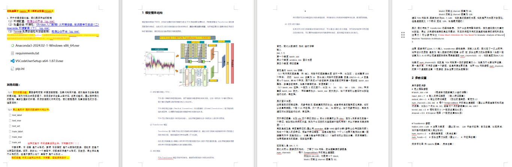
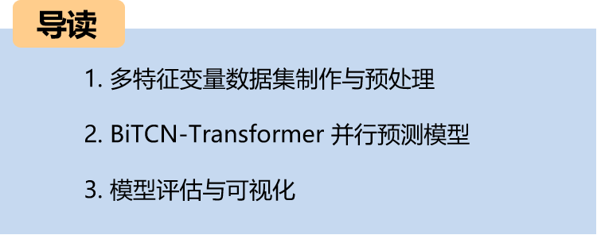
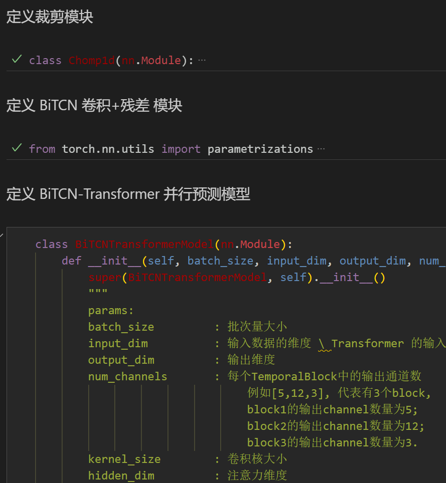
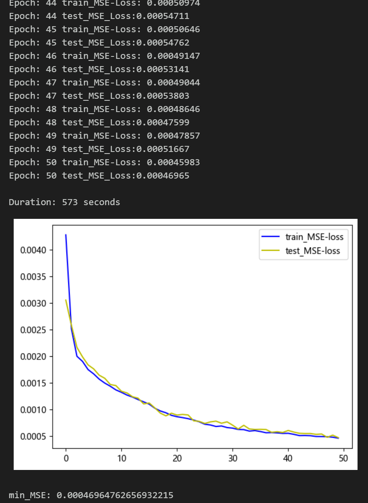
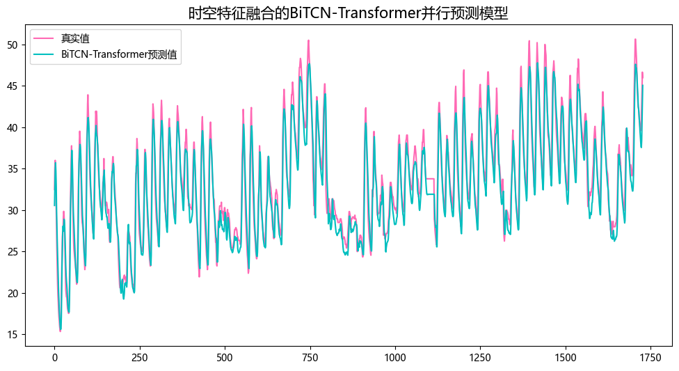
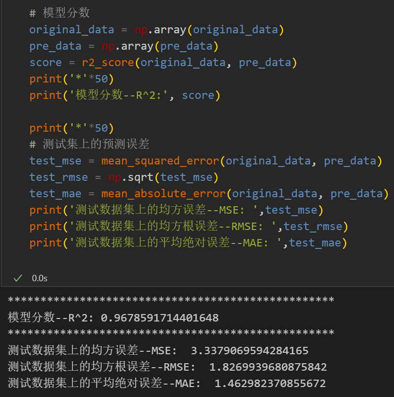
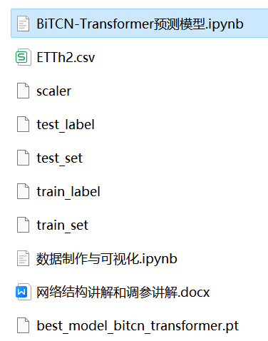

# BiTCN-Transformer Model with Integration of Spatiotemporal Features for Parallel Prediction

Environment: Python 3.9, PyTorch 1.8 and above are all compatible.
Model innovation points, for students with graduation thesis or need to publish a small paper, must see this, rich module, high innovation degree, excellent performance! Innovation points:
1. BiTCN module: The BiTCN module is used to extract temporal spatial features. The BiTCN consists of multiple TemporalBlocks, each TemporalBlock contains two convolution layers, batch normalization and ReLU activation function, as well as dropout layer. In addition, BiTCN also applies weight normalization processing, accelerating convergence and improving the generalization ability of the model.
2. Transformer module: The Transformer encoder module is used to extract temporal features. The superior structure and multi-head attention mechanism of the Transformer encoder can effectively capture the temporal dependencies in sequence data, improving the model's ability to model time series.
3. Sequence average pooling and fully connected layer: At the final stage of the model, the spatiotemporal features are fused, using sequence average pooling operation and fully connected layer for prediction. Such design can effectively map the spatiotemporal features to the prediction space, achieving accurate prediction of sequence data.
Note: This product also comes with accompanying model explanations and parameter tuning explanations!
Preface
This article introduces a parallel prediction model that integrates spatiotemporal features based on the previous introduction of power transformer ([reference link](#dataset)), aiming to improve the prediction performance of time series data.
Introduction to the Power Transformer Dataset
The detailed introduction to the power transformer dataset and its preprocessing can be referred to in the following text:
Power Transformer Dataset Introduction and Preprocessing
This model is applicable to multivariate feature | univariate sequence prediction!
1. Overall Model Structure
The overall structure of the model is as follows: multi-feature variable time series data first undergoes BiTCN network extraction of global spatial features, and at the same time, data passes through Transformer network to extract temporal features. Then, they fuse the spatiotemporal features, and finally, high-precision predictions are made through fully connected layers.
(1) Bidirectional SpatioTemporal Convolution Network (BiTCN):
BiTCN (Bidirectional SpatioTemporal Convolution Network) is a neural network model used for processing time series data. It mainly extracts temporal spatial features to capture the spatial correlation and temporal dependence in the sequence data.
Bidirectionality: BiTCN includes two-way convolution operations, respectively used for forward and backward time series data. This bidirectional design can effectively capture the relationship between the previous and subsequent elements in the sequence data, improving the model's ability to model temporal dependence.
Spatiotemporal Convolution: BiTCN uses spatiotemporal convolution operations that slide convolution kernels on both time and space dimensions to obtain feature information at different time points and spatial locations in the sequence data. This convolution operation can effectively capture local patterns and global trends in the sequence data.
Multi-layer structure: BiTCN usually consists of multiple TemporalBlocks, each containing two convolution layers, batch normalization, ReLU activation function, and dropout layer. This multi-layer structure can gradually extract abstractive level temporal spatial features to improve the model's representation capability.
Weight normalization: To accelerate convergence and improve generalization ability, BiTCN often performs weight normalization on the convolution kernels. This processing can effectively reduce the gradient vanishing and exploding problems during training, thereby improving the stability and generalization ability of the model.
Transformer module:
Transformer models perform better in handling long-distance dependencies and can efficiently parallelize computations, suitable for large-scale datasets.
1. Encoder: The Transformer model consists of several encoder stacks, each composed of multiple identical layers. Each layer includes two sub-layers: Self-Attention and Feed-Forward Neural Network.
2. Multi-Head Attention: To enhance the model's expressiveness and capture richer features, the Transformer model introduces a multi-head attention mechanism. In this mechanism, the hidden representations of the input sequence are processed through multiple different attention heads, and then the outputs from different heads are concatenated and linearly transformed.
3. Data Preprocessing for Multi-Feature Variable Datasets
   2.1 Importing Data
   2.2 Creating the Dataset
   2.3 Making the Dataset and Classification Labels
4. High Precision Parallel Prediction Model Based on BiTCN-Transformer
   4.1 Defining the Network Model
   4.2 Setting Up Parameters and Training the Model
   50 epochs, MSE is 0.000469, Multi-variable feature BiTCN-Transformer parallel fusion network model prediction effect is significant, the model can fully extract spatial and temporal features of time series, converges quickly, has excellent performance, high prediction accuracy, appropriately adjusting model parameters can further improve the model prediction performance.
   Adjusting parameters:
   - Increase the number of BiTCN layers and channels per layer, fine-tune learning rate;
   - Adjust the number of Transformer encoder layers, multi-head attention heads, and attention dimensions, increase more epochs (note to prevent overfitting);
1. Adjustable sliding window length (set appropriate window length)
3.3 Model evaluation and visualization
Prediction result visualization
Model evaluation
Previously excellent content:
Time series forecasting: Analysis and comparison of LSTM, ARIMA, Holt-Winters, SARIMA models
Wind speed prediction (I) Data set introduction and preprocessing
Wind speed prediction (II) EMD-LSTM model based on Pytorch
Wind speed prediction (III) EMD-LSTM-Attention model
Wind speed prediction (IV) EMD-Transformer model based on Pytorch
Wind speed prediction (V) EMD-CNN-LSTM model based on Pytorch
Wind speed prediction (VI) EMD-CNN-GRU parallel model based on Pytorch
CEEMDAN + combined forecasting model (BiLSTM-Attention + ARIMA)
CEEMDAN + combined forecasting model (CNN-LSTM + ARIMA)
CEEMDAN + combined forecasting model (Transformer - BiLSTM + ARIMA)
CEEMDAN + combined forecasting model (CNN-Transformer + ARIMA)
Multi-feature variable sequence prediction (I) - CNN-LSTM wind speed prediction model
Multi-feature variable sequence prediction (II) - CNN-LSTM-Attention wind speed prediction model
Multi-feature variable sequence prediction (III) - CNN-Transformer wind speed prediction model
Multi-feature variable sequence prediction (IV) Transformer-BiLSTM wind speed prediction model
Multi-feature variable sequence prediction (V) CEEMDAN+CNN-LSTM wind speed prediction model
Multi-feature Variable Sequence Prediction (6) CEEMDAN+CNN-Transformer Wind Speed Prediction Model
Prediction Model Based on the Particle Swarm Optimization Algorithm SSA: CEEMDAN-BiLSTM-Attention
Prediction Model Based on the Particle Swarm Optimization Algorithm SSA: CEEMDAN-Transformer-BiGRU
Superior Prediction Model: Secondary Decomposition-Combination Prediction
Multi-feature Variable Sequence Prediction (7) CEEMDAN+Transformer-BiLSTM Prediction Model
Multi-feature Variable Sequence Prediction (8) Prediction Model Based on the Particle Swarm Optimization Algorithm for CEEMDAN-SSA-BiLSTM
Multi-feature Variable Sequence Prediction (11) Prediction Model Based on Pytorch's TCN-GRU
VMD + CEEMDAN Secondary Decomposition, CNN-LSTM Prediction Model
VMD + CEEMDAN Secondary Decomposition, CNN-Transformer Prediction Model
Prediction Model Based on the Particle Swarm Optimization Algorithm SSA: Code All-in-One Kit
| Superior Combination Prediction Model!
High Innovation | CEEMDAN + SSA-TCN-BiLSTM-Attention Prediction Model
| Superior Combination Prediction Model!
Lowest Price Online | Continuous Updates for the All-in-One Kit!
| Parallel Prediction Model Based on TCN-SENet + BiGRU-GlobalAttention
Secondary Decomposition - Innovative Model Prediction All-in-One Kit
| BiTCN-BiGRU-CrossAttention Fusion Spatiotemporal Features High Innovation Prediction Model
END
2. Friends who like this can click to follow, give the article a "like", share it in WeChat groups or discuss in discussion groups
Modeling Pioneer
233 original contents

## Images

<!-- PAYMENT_BLOCK -->

## Get this dataset

- Payment link (Stripe): [Buy now](https://buy.stripe.com/3cs8yP7sY87d0vu9AB)
- Payment QR code: 

<!-- /PAYMENT_BLOCK -->
